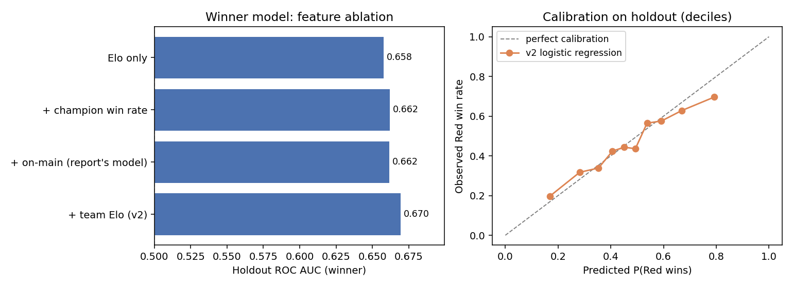

# League of Legends Pro-Match Prediction

Predicting professional *League of Legends* games from pre-game information alone. Given the ten players, their champions, and the teams in each 2023 game, the model predicts **who wins**, **how many kills each player gets**, and **how long the game lasts**. It trains on about 41,000 pro games from 2018–2022 across 89 leagues.

This is a **Python rebuild (v2)** of a STAT 440 Kaggle-style contest project (Simon Fraser University, Fall 2025, team *MedQueue*, 7 people). The team's original work was done mostly in R and shared informally, and its final code wasn't preserved. I reimplemented the approach described in our report from scratch, fixed its evaluation, and extended it.

**Stack:** Python · pandas · scikit-learn · XGBoost · matplotlib

---

## Results

The official 2023 answers aren't available, so v2 is evaluated the way the report recommended: a **chronological holdout**. It trains on the first 85% of games and tests on the last 15% (Jun–Dec 2022, 6,177 games), with every feature frozen at the end of the training window, exactly as it would be when predicting 2023. Scores use the contest's own formula (below).

| Model | Contest score | Winner AUC | Kills MAE | Length RMSE (s) |
|---|---|---|---|---|
| Zero point (coin toss, 0 kills, mean length) | −0.5% | 0.500 | 2.86 | 340 |
| Simple priors (position-mean kills, league-mean length) | 11.5% | 0.500 | 1.87 | 337 |
| **v2 (logistic regression + XGBoost)** | **24.4%** | **0.670** | **1.76** | **334** |

For context, the team's best public-leaderboard score on the real 2023 test set was 21.6%. That's a different test set, so the two numbers aren't directly comparable.



What the holdout shows:

- **Skill ratings carry the winner signal.** Player Elo alone reaches AUC 0.658. Champion win rates add a little. The report's "playing their main champion" feature adds **nothing** (0.6620 → 0.6618), which matches our leaderboard experience (21.445% → 21.641%, within noise). A **team-level Elo** is the most useful addition in v2.
- **Kills are mostly position and player habits.** Priors by position, player, champion, and league, fed to XGBoost with an absolute-error objective (the contest scores MAE), cut error by 6% versus position means.
- **Game length is nearly unpredictable before the game starts.** The best model barely beats the league average (RMSE 334 s vs. 337 s). That third of the score stays close to zero for every approach we tried.
- **Calibration:** predicted probabilities are well ordered but slightly overconfident at the extremes. Ratings frozen for six months go stale as rosters and the meta change.

## How it works

Contest score = ⅓ · 2(AUC − 0.5) + ⅓ · (1 − MAE<sub>kills</sub>/2.83) + ⅓ · (1 − RMSE<sub>length</sub>/339.15). The constants make a coin toss, all-zero kills, and the mean game length each score 0.

**Leak-free features.** The first version of our model hit about 99% validation accuracy, then scored under 10% on the leaderboard. Future games had leaked into the player-strength estimates. v2 prevents this by construction: `FeatureBuilder` walks games in date order, computes each game's features **only from earlier games**, then updates its state.

| Target | Model | Features (red − blue where relevant) |
|---|---|---|
| Winner | Logistic regression | Player Elo difference (team mean), team Elo difference, champion win-rate difference (Bayesian-smoothed), players-on-main-champion difference |
| Kills (per player) | XGBoost, absolute-error loss | Smoothed kill averages by position, champion × position, player, player × position, and league × position; own/opponent Elo; experience |
| Game length | XGBoost, squared-error loss | League average length, champion average length, Elo closeness and level, share of known players |

Unseen players (about a quarter of the players in 2023) start at the default Elo of 1500, and unseen champions fall back to smoothed priors.

## My role

- **In the original team project:** I wrote the report's section on **overfitting**: diagnosing the look-ahead leakage and moving to a chronological train/validation split. I also contributed to the "additional approaches" section and built early R baselines (main-champion lookup, Elo and kill-prior preparation).
- **This v2:** I rebuilt the whole pipeline in Python and added streaming leak-free features, team Elo, the contest-metric holdout evaluation, and the ablation study. One fix from reviewing my original R baseline: it submitted **hard 0/1 winner labels**, which throws away AUC. v2 submits probabilities.

## Running it

The contest data (`train.csv`, `Xte.csv`) was provided through the course and is **not included**. Place the files in `data/`.

```bash
pip install -r requirements.txt
python scripts/evaluate.py --train data/train.csv          # holdout scores + results/winner_model.png
python scripts/predict.py  --train data/train.csv --test data/Xte.csv --out submission.csv
```

Each script takes about 3 minutes on a laptop CPU.

## Repository layout

```
src/lolpred/
├── data.py       # load player-level train / game-level test into a common Game structure
├── features.py   # streaming, leak-free Elo / win-rate / kill / length features
├── models.py     # logistic regression (winner), XGBoost (kills, length)
└── metrics.py    # the contest scoring rule
scripts/
├── evaluate.py   # chronological holdout, baselines, ablation, figure
└── predict.py    # train on 2018–2022, predict 2023
results/          # metrics.json + figure from the last evaluation run
```

## Next steps

- Let ratings keep updating through a season, or decay them toward the mean, to fix the staleness that shows up as overconfidence.
- Glicko-style ratings that track uncertainty, which matters for players with few games.
- Poisson or Tweedie models for kills (count data), and a log-scale target for game length.
- Expanding-window validation across multiple seasons instead of a single holdout.
